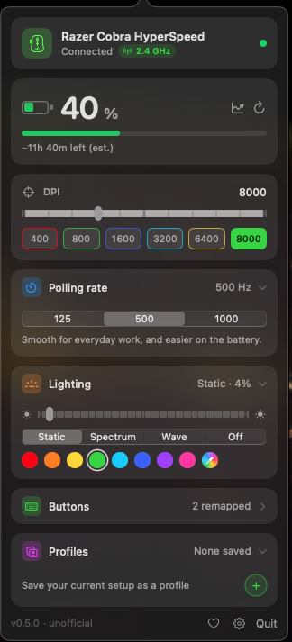
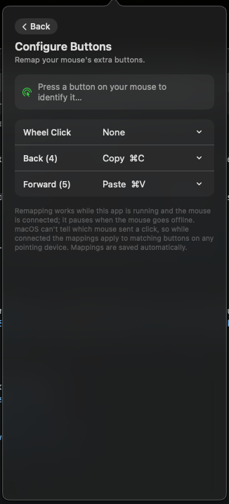
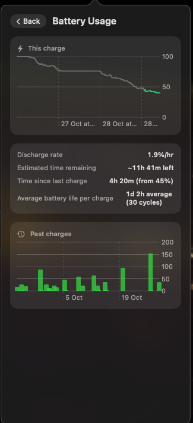

# Razer mouse control for macOS

A native menu bar app to control Razer mice on macOS. Razer does ship a Synapse for Mac now,
but its [supported-device list](https://mysupport.razer.com/app/answers/detail/a_id/14809/~/razer-synapse-for-mac-supported-and-compatible-devices)
is short and doesn't include the Cobra HyperSpeed or Atheris — this fills that gap. It talks
to the mouse directly over USB HID (no kernel extension, no driver install), using a protocol
ported from [OpenRazer](https://github.com/openrazer/openrazer).

Works best with the **Razer Cobra HyperSpeed** and the **Razer Atheris**, the two devices this
has actually been tested on. It detects any Razer mouse by name and should work with other
Razer mice that use the same HID protocol family, but those are untested, so treat support as
"likely to work, not verified" until someone confirms it on real hardware.

> Unofficial. Not affiliated with, authorized by, or endorsed by Razer Inc. See [NOTICE.md](NOTICE.md).
> 
> 
> 
> 


## Features

- **Battery** percentage in the menu bar, charging status, and a learned time-until-empty
  estimate. History and the estimate are kept per physical device (by serial number).
- **Battery usage graph**: a chart button beside the battery percentage opens the current
  discharge curve, the discharge rate, time since the last full charge, and a trend chart of
  past charge cycles with their average length.
- **DPI** with a slider (capped at each model's real maximum), the mouse's own preset stages
  read from the device, and a recallable custom value (per device).
- **Polling rate**: 125 / 500 / 1000 Hz.
- **RGB lighting**: static colour via an inline hue/saturation wheel, plus spectrum, wave, off,
  and a brightness slider.
- **Low battery alert**: a notification when the battery drops below 15%, once per charge.
- **Profiles**: save DPI, polling rate, lighting and button remaps under a name, and switch
  between them from the popover. Saved per device.
- **Themes**: System, Dark, Light or Razer Green, with an optional glass effect, in
  Settings › Appearance. A two-column popover is there too. It's always used while a keyboard
  or mousepad is connected.
- **Connection sounds** when the mouse connects or disconnects (can be turned off).
- **Button remapping** for the side Back/Forward buttons (software, via a CGEvent tap):
  keyboard shortcuts (presets or a custom recorder), mouse clicks, and media keys. Saved per
  device.
- **Any Razer mouse is detected and named.** Controls a model lacks are hidden automatically
  (no lighting on the Atheris, no battery UI on wired-only mice). A Razer keyboard or other
  product that is never a mouse is not taken for one.
- **Keyboard and mousepad lighting.** Each Razer keyboard or mousepad next to the mouse gets
  its own card in the popover, with its own colour, effect and brightness. Each can also
  follow the mouse's lighting. Tested on the Cynosa Chroma keyboard and the Firefly V2
  mousepad. The Cynosa Chroma Pro, Cynosa Lite, Ornata V3 family, Firefly V2 Pro and
  Goliathus Chroma pads use the same commands but are untested.
- **Asks for help with a new mouse.** When a mouse MacRazer doesn't fully support connects, a
  small window offers the device test (see below). It can be turned off in Settings.
- Settings are written to the mouse's **onboard memory** where supported, so they persist when
  the app is not running.
- **Starts at login** (on by default, switchable in the popover and in System Settings ›
  General › Login Items), so the menu bar item is there after a reboot.
- **Updates install themselves**: when a new release is out, "Update & Restart" downloads it,
  checks it, replaces the installed app and relaunches — no dragging a DMG. It falls back to
  the plain DMG download when MacRazer is somewhere it can't replace itself (still on the disk
  image, or in a folder you can't write to). The card also links to **what's in the release**,
  so the choice isn't blind.

Settings persist across app restarts and reconnects, and the menu bar updates on its own when
the mouse connects, disconnects, or sleeps.

## Supported mice

"Verified" below means someone ran the CLI probes or the in-app test against the mouse and
posted the output, not that the protocol tables say it should work. Where nobody has, the row
says so.

| Mouse | Verified on hardware | By |
|---|---|---|
| Razer Cobra HyperSpeed (wired + wireless) | Everything, continuously — the development mouse | maintainer |
| Razer Atheris | Battery, DPI, polling | maintainer |
| Razer Basilisk V3 X HyperSpeed | Battery, DPI, DPI stages, polling, lighting, brightness | [@joelday](https://github.com/joelday) |
| Razer Viper Ultimate (Wireless) | Battery, DPI, polling, brightness | [@raphaelchenouard](https://github.com/raphaelchenouard) |
| Razer Naga Pro (Wireless) | Battery, DPI, DPI stages, polling, lighting, brightness | [@sidneylopes](https://github.com/sidneylopes) |
| Razer Naga V3 Pro (Wireless) | Battery, DPI, DPI stages, polling, lighting, brightness | [@chris-agnew](https://github.com/chris-agnew) |
| Razer Naga V3 Pro (Wired) | Battery, DPI, DPI stages, polling, lighting, brightness | [@chris-agnew](https://github.com/chris-agnew) |
| Razer Naga Trinity | DPI, DPI stages, polling, lighting, brightness | anonymous report |
| Razer Viper V3 HyperSpeed | Battery, DPI, DPI stages, polling | anonymous report |
| Razer Basilisk V3 | DPI, DPI stages, polling, lighting, brightness | SuperSpacer54376 |
| Razer DeathAdder Essential | DPI, DPI stages, polling, brightness (its one light is green only) | anonymous report |
| Razer Basilisk V4 HyperSpeed | Battery, DPI; polling not working yet | anonymous report |
| Razer Viper V4 Pro (Wired) | Battery, DPI, DPI stages; polling not working yet | anonymous report |
| Razer Basilisk V4 Pro (Wireless) | Battery, DPI, DPI stages, lighting, brightness; polling not working yet | anonymous report |
| Razer DeathAdder V3 HyperSpeed | DPI, DPI stages, polling; battery not answering yet | anonymous report |
| Razer DeathAdder V2 Pro (Wireless) | Battery; DPI, polling and lighting not tested yet | anonymous report |
| Razer Mouse Dock Pro (with a Naga V3 Pro) | Battery, DPI, lighting, brightness; polling not working yet | anonymous report |
| Razer Naga Chroma | DPI, polling; lighting not working yet | anonymous report |
| Razer Orochi 2013 | DPI only | [@raphaelchenouard](https://github.com/raphaelchenouard) |
| Razer DeathAdder Essential (2018, White Edition) | Nothing; values from OpenRazer | — |
| Razer Cobra, Cobra Pro (wired + wireless) | Nothing; same protocol family, values from OpenRazer | — |
| Razer Basilisk X HyperSpeed | Nothing; values from OpenRazer | — |
| Razer Viper Ultimate (Wired) | Nothing; its wireless sibling is verified | — |
| Razer Naga Pro (Wired) | Nothing; its wireless sibling is verified | — |
| Any other Razer mouse | Nothing; detected and named, controls attempted | — |

An unverified mouse is not a broken one. Detection and naming work for any Razer mouse, and
the controls are attempted with values taken from OpenRazer's tables — they usually work. The
column is about who has actually seen it happen.

**Have a mouse that isn't verified?** The quickest way to help is in the app. Right-click the
menu bar icon and choose **Help Support This Mouse…**. It runs the same probes as the
commands below, puts every setting back, and builds the report for you. **Send** emails it to
the maintainer, or you can copy it or open a GitHub issue with it. If part of your mouse is
already verified, the test lists what works and offers to check only what's missing. It also
says which of the mouse's other connections (cable, dongle, Bluetooth) still need a report. On
a verified mouse the item reads **Test This Mouse…**. The window says no test is needed, but you
can still run one to confirm it works on your firmware. The full
test needs the dongle or a cable. A mouse on Bluetooth gets a shorter test that only reads.

You don't have to find the menu item. When an unverified mouse connects by cable or dongle,
MacRazer asks once, when no other window is open. A partly verified mouse is asked about just
what's missing. A mouse verified on one connection but not another (say, the dongle but not
the cable or Bluetooth) gets a note telling you which and how to switch. If you say Not Now, it reminds you once a
week later and then stops. A card at the top of the popover offers the same test until you send
a report or hide it. "Don't ask for this mouse" stops both for that model. If the mouse is
plugged in before Input Monitoring is allowed, the window starts with that permission. To turn
all of this off, use Settings › General › **Ask me to help test my mouse**.

### What a device report contains

You can read the whole report on the last screen before it goes anywhere.

- The mouse's name, product ID and firmware version, and whether it's on a cable or the dongle.
- Its USB interfaces: product IDs, usage pages and report sizes.
- What each step found: which transaction ids the mouse answered to, the battery level, the
  DPI and polling rate it read and wrote back, and the lighting brightness. Every command the
  test sent is listed, with the first 8 bytes of each answer.
- Whether the mouse answers about 30 more read-only commands: newer polling rates, the sleep
  timer, scroll wheel settings, profiles stored in the mouse, saved button functions and each
  lighting zone. These only read, so nothing on the mouse changes. They show which features
  are worth adding for it.
- If the mouse keeps a button function table, every entry in it. With the buttons you press,
  that is most of what's needed to remap them.
- If no transaction id answers, whether the mouse's other interfaces do.
- From the Bluetooth test: the Bluetooth services the mouse has, its standard battery level,
  and which of Razer's Bluetooth commands it answers, button table included.
- Which extra buttons you pressed during the button step, not when.
- The app and macOS versions.
- Only if you fill them in: a comment, a name to credit, and an email address for a reply.

Never in it: the mouse's serial number, or anything else about your Mac.

Where it goes depends on the button. **Copy** puts it on your clipboard. **Open GitHub issue**
makes it public, so it leaves out your email address. **Send** emails it to the maintainer
through a small Cloudflare Worker, which keeps nothing but a count of reports per day. Its code
is in a private repository, and builds from this repository don't have Send: they offer Copy
and the GitHub issue instead.

Adding a model is a small change to a registry plus on-hardware verification. See
[CONTRIBUTING.md](CONTRIBUTING.md).

### Buttons MacRazer cannot see

Remapping works by watching macOS mouse events, so it can only reach buttons the mouse
actually reports to the Mac. Some buttons are handled *inside* the mouse and never send
anything — no app can detect those, MacRazer included.

The clearest example is the **Basilisk's multi-function trigger** (the third side button),
which ships assigned to **Razer Hypershift**. Hypershift is a modifier: held down, it
switches every other button to a second onboard layer. The firmware resolves that layer
itself, so pressing the trigger alone puts no report on the wire at all — verified by
watching every HID interface the mouse exposes while it was pressed.

To make it remappable, reassign it from Hypershift to a normal key or mouse button in
Razer Synapse (Windows only — Razer dropped macOS support). The assignment is stored in the
mouse's onboard memory, so it persists on the Mac afterwards and MacRazer will then see the
button like any other. MacRazer deliberately does not reprogram onboard assignments itself;
that would mean reverse-engineering Synapse, which Razer's EULA forbids.

### Known limitation: two identical mice without a hardware serial

Per-device settings (custom DPI, button remaps, battery history) are keyed by the mouse's own
serial number when it reports one, otherwise by its USB product ID. If you own **two mice of
the exact same model and that model doesn't expose a serial**, both fall back to the same
PID-based key and will share one settings/history file: there's no other stable identifier to
tell them apart. This doesn't affect mixed setups (different models, or models that do report
a serial).

## Requirements

macOS 14 or later, on Apple Silicon or Intel.

**Connect over the 2.4 GHz dongle or a USB-C cable.** That's where Razer exposes its full
control protocol. The **Cobra HyperSpeed also works over Bluetooth**: battery, DPI stages,
brightness and a static lighting colour. Polling rate, other lighting effects, custom DPI
values and profiles still need the dongle or a cable. MacRazer asks for Bluetooth access the
first time it finds the mouse there.

Other models are a plain pointer over Bluetooth, so MacRazer can't read or change anything.
If your mouse has a mode switch, set it to 2.4 GHz. MacRazer tells you when it sees your
mouse on Bluetooth.

## Install

Download [`MacRazer.dmg`](https://reports.macrazer.com/v1/download?via=site&page=readme)
(release notes on the [latest release](../../releases/latest) page), open it, and drag
**MacRazer** into Applications.

This build is unsigned (no paid Apple Developer ID), so on first launch Gatekeeper will say
the app "cannot be opened because it is from an unidentified developer" or "is damaged and
can't be opened". Both are the standard unsigned-app warning, not an actual problem. To open
it anyway, do **one** of:

- Right-click (or Control-click) **MacRazer.app** in Finder, choose **Open**, then confirm
  **Open** in the dialog. (Only needed once.)
- Or, in System Settings > Privacy & Security, scroll to the bottom and click **Open Anyway**
  next to the MacRazer warning.
- Or, from Terminal: `xattr -cr /Applications/MacRazer.app`, then open it normally.

After that it launches like any other app. It will then ask for **Input Monitoring**
permission (and **Accessibility** if you use button remapping); see [Permissions](#permissions)
below.

## Build and run

To build from source: Xcode 16 / Swift 6.1.

```sh
# Run the menu bar app directly (easiest while developing; uses your Terminal's permissions):
swift run MacRazer

# Or build a standalone .app:
./Scripts/setup-signing.sh      # one-time: a stable self-signed identity (see Permissions)
./Scripts/build-app.sh          # produces "MacRazer.app"
open "MacRazer.app"
```

## Permissions

- **Input Monitoring** is required to send and receive HID reports to the mouse. The app
  requests it on launch; grant it in System Settings > Privacy & Security > Input Monitoring.
- **Accessibility** is required only for button remapping (the event tap). The remap screen
  has a button to open the right settings pane.

macOS binds a permission grant to the app's code signature. An ad-hoc build gets a new
signature on every rebuild, which resets the grant, so either run `Scripts/setup-signing.sh`
once (it creates a stable self-signed identity that `build-app.sh` then uses) or develop with
`swift run MacRazer`, which inherits your Terminal's grants.

If a build seems to stop dead at the codesigning step, it hasn't crashed: macOS is showing a
keychain prompt for the signing key (the build script says so once it has been waiting a few
seconds). Click **Always Allow** (not Allow), then run `Scripts/setup-signing.sh --repair`
once to grant codesign standing access so nothing prompts again.

## Command-line diagnostics

The same binary runs read-only probes when given a subcommand (handy for verifying a new
mouse). Run these from a terminal:

```sh
swift run MacRazer info                 # list the mouse's HID interfaces
swift run MacRazer battery              # read battery %
swift run MacRazer dpi [x] [y]          # read or set DPI
swift run MacRazer poll [125|500|1000]  # read or set polling rate
swift run MacRazer rgb static ff0000    # static colour (or: spectrum | wave [speed] | off)
swift run MacRazer rgb breathing ff0000 # breathing (two colours for dual, none for random)
swift run MacRazer brightness [0-100]   # read or set LED brightness
swift run MacRazer discover             # which transaction ids the mouse answers to
swift run MacRazer devicetest           # the in-app device test, printed as JSON
```

## How it works

The mouse speaks Razer's HID protocol. We did not reverse-engineer it: the command bytes were
ported from OpenRazer's Linux driver and reimplemented in Swift over Apple's IOKit HID
Manager. No kernel extension is needed because Razer mice respond to standard USB HID feature
reports that any userspace process can send.

Full details, including the protocol, the per-device hardware quirks, and a file-by-file map,
are in [Documentation/DOCUMENTATION.md](Documentation/DOCUMENTATION.md). The complete feature history is in
[CHANGELOG.md](CHANGELOG.md).

## Built with

MacRazer was built with [Hiveship](https://hiveship.app/), an issue tracker for planning work,
tracking bugs, and handing issues to coding agents as well as the people on your team.

## Contributing

Pull requests are welcome, especially **device profiles** so this works on more Razer mice.
See [CONTRIBUTING.md](CONTRIBUTING.md).

## License

GPL-2.0-or-later, see [LICENSE](LICENSE). The project is GPL because its HID protocol is
derived from OpenRazer. Full attribution and the trademark notice are in [NOTICE.md](NOTICE.md).

## Support

This is a free, unpaid community project. If it is useful to you, you can leave a tip:
[ko-fi.com/sorcrr](https://ko-fi.com/sorcrr).
